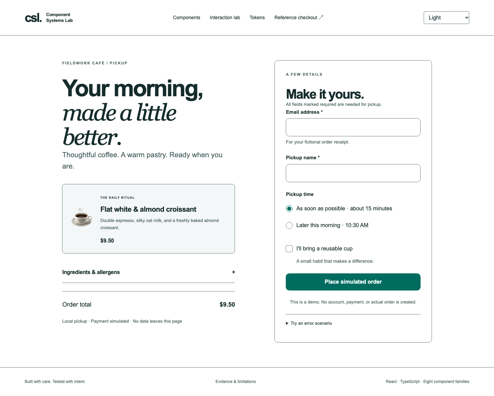

# Component Systems Lab

[](https://github.com/kashishdesai01/Component-Systems-Lab/actions/workflows/ci.yml)

A React component system with semantic design tokens, explicit keyboard and focus behavior, interactive documentation, and a fictional café checkout reference application.



## Components

| Family              | Behavior                                                                                        |
| ------------------- | ----------------------------------------------------------------------------------------------- |
| Button / IconButton | Native activation, explicit submit behavior, focusable disabled state, named icon actions       |
| TextField           | Associated labels, hints and errors; native input props and refs                                |
| Checkbox            | Native selection, labeled targets and uncontrolled form reset                                   |
| RadioGroup          | Native fieldset/legend, form values, controlled selection and canceled-reset handling           |
| Tabs                | Horizontal LTR/RTL navigation, roving focus, manual or automatic activation                     |
| Accordion           | Heading buttons, expanded relationships and independently hidden panels                         |
| Menu                | Action popup, arrow navigation, typeahead, disabled items and predictable exit behavior         |
| Dialog              | Native modal background inertness, scoped Tab wrapping, initial/return focus and scroll cleanup |

Three themes share the same semantic vocabulary: light, dark and high contrast. Token generation produces CSS variables, a Tailwind v4 theme bridge and TypeScript declarations. Contrast tests cover the allowed opaque foreground/background combinations.

## Getting started

Requires Node.js 22.23.2 or a compatible Node 22 release, and pnpm 11.25.0.

```sh
pnpm install --frozen-lockfile
pnpm dev
```

To preview the production static export:

```sh
pnpm build
pnpm serve
```

Open `http://127.0.0.1:3100`. The site includes component documentation, an interaction lab, a token browser, support limitations and the reference checkout.

## Package usage

```tsx
import '@csl/tokens/css';
import '@csl/ui/styles.css';
import { Button, TextField } from '@csl/ui';

export function ContactForm() {
  return (
    <form>
      <TextField label="Email address" name="email" type="email" required />
      <Button type="submit">Continue</Button>
    </form>
  );
}
```

Applications own validation, submission, controlled state and announcement timing. Components own their documented semantic relationships and interaction behavior.

## Workspace

| Package    | Responsibility                                                                       |
| ---------- | ------------------------------------------------------------------------------------ |
| `tokens`   | JSON token sources, generated theme exports and contrast contracts                   |
| `ui`       | React components, CSS Modules, typed APIs and colocated accessibility contracts      |
| `docs`     | Next.js App Router/MDX static documentation and Redux checkout example               |
| `e2e`      | Playwright browser, axe and keyboard-flow verification                               |
| `consumer` | Standalone installation of packed UI/token artifacts, declaration and runtime checks |

Components consume CSS variables and remain independent of Redux and Tailwind. The modal uses native `showModal()` plus the maintained `tabbable` utility and a radio-group boundary policy. The checkout simulates a local submission lifecycle; it does not create an order, process payment or send personal information to a server.

## Verification

```sh
pnpm --filter @csl/e2e exec playwright install --with-deps
pnpm verify
pnpm test:coverage
pnpm test:mutations
pnpm measure:bundle
```

The browser suites start their own static servers. Verification builds dependencies in order, checks the production export, and installs packed packages outside the workspace. Every installed dist artifact is compared with the current build before standalone declaration and browser checks.

Run sentinel mutations separately: that command temporarily modifies source and restores it after checking the expected assertion failures. Bundle measurements use a documented Button-only fixture with React externalized and CSS reported separately.

See [verification results](docs/verification.md), [engineering notes](docs/engineering-notes.md) and [bundle measurements](docs/performance.md).

## Accessibility and support

Native semantics, accessible names, keyboard paths, focus management and form relationships are specified beside each component. Automated checks cover defined states and preserve inconclusive axe results for inspection.

Manual screen-reader compatibility, actual browser zoom, text-only resizing, operating-system forced colors and inclusive user testing remain unverified.

## Delivery

GitHub Actions runs type checking, lint, unit tests, package-consumer verification and browser checks. Azure Static Web Apps deployment is available through a manual workflow and requires an `AZURE_STATIC_WEB_APPS_API_TOKEN` repository secret. 

Changesets manages package versions and changelogs. Packages remain private and are not published to npm. Initial commit organization is documented in [repository history](docs/history.md).
